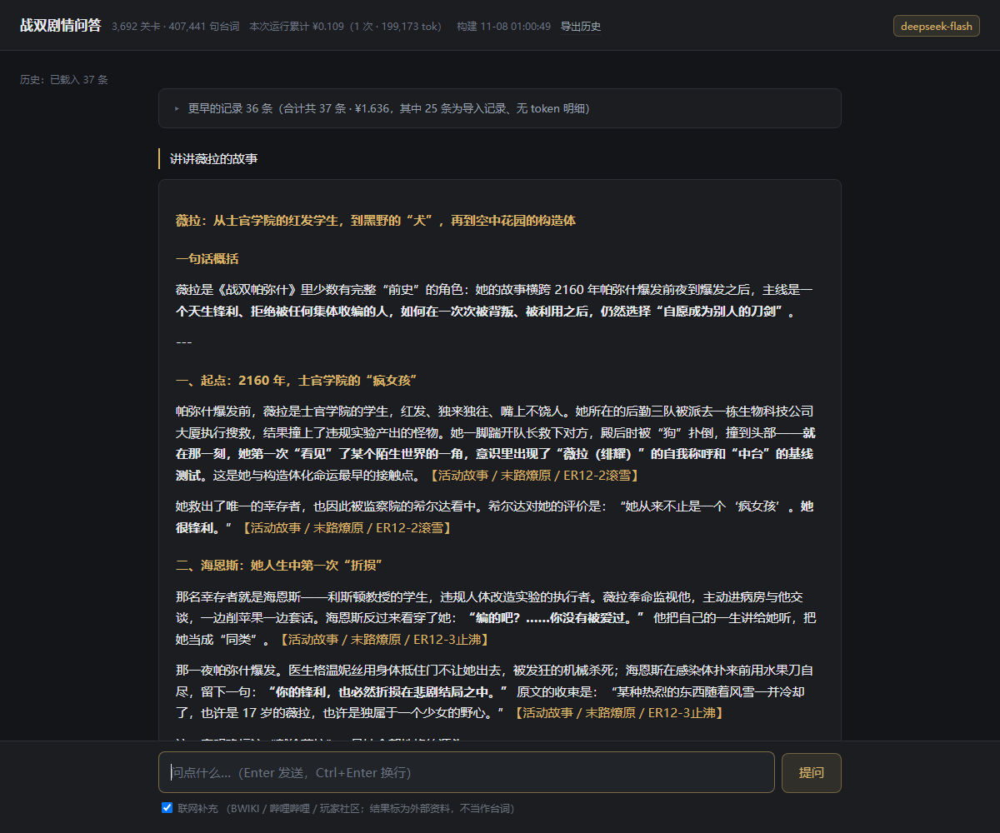

# 战双剧情问答 · PGR Story QA



把《战双帕弥什》全部剧情语料收进本地一个数据库，用自然语言提问，回答带可点击的出处和原文。语料 3,692 个关卡、1,113 万字，来自 [战双 BWIKI](https://wiki.biligame.com/zspms/剧情回顾)。

**当前版本：v1.0.0**

## 功能

- **会自己查资料的问答**：不是固定检索管线。模型通过工具自己决定查什么——查角色档案、翻章节目录、读整章原文、检索台词，多轮之后再作答。
- **出处可点击**：每条结论标注【分类／章节／关卡】，点开直接显示该关原文（本地读取，不联网）。
- **不提问也能看原文**：页头「原文」按章节点开，或直接搜关卡名 / 章节 / 序号。没有 Key、没有历史时也能用。
- **有据可依，无据可推**：原文没直接写但有线索时，明确标「推断」并列出依据；连线索都没有才说没有。
- **出处强制校验**：答案里的每个出处都会拿去数据库核对，编号写错自动改正，关卡不存在标为【未核实】。
- **追问接得上**：刷新页面后仍保留本次会话，追问沿用上文。
- **历史自动保存**：每条问答落盘（时间、工具链、出处、token、人民币费用），可导出 Markdown。
- **费用可见**：单次花费按 DeepSeek 官方价目计算，区分缓存命中与高峰/空闲时段。
- **深色 / 浅色主题**：页头一键切换，选择记在浏览器里；首次默认跟随系统。
- 纯 Python 标准库，无第三方依赖；只需一个 DeepSeek API Key。

## 每次提问花多少钱

实测自 38 次提问（`data/history.db` 的真实记录，deepseek-flash 价目、空闲时段）：

| 指标 | 金额 |
|---|---|
| **中位数** | **¥0.037** |
| 平均 | ¥0.044 |
| P25 / P75 | ¥0.020 / ¥0.060 |
| P90 | ¥0.100 |
| 最低 / 最高 | ¥0.002 / ¥0.123 |

按问题类型差别很大：

| 问题类型 | 次数 | 中位花费 | 中位上下文 |
|---|---|---|---|
| 「讲讲 XX 的故事」（跨章节归纳） | 2 | ¥0.116 | 24 万 token |
| 其它（查人、查设定、定位台词） | 11 | ¥0.030 | 6.4 万 token |

（类型拆分只统计那 13 条有 token 明细的记录，样本很小，仅供量级参考。）

差 4 倍的原因不是问题长短，而是**工具调用步数**——每多跑一轮，累积的上下文就要重发一遍：

| 工具步数 | 典型花费 |
|---|---|
| 1~3 步 | ¥0.002 ~ ¥0.013 |
| 4~6 步 | ¥0.024 ~ ¥0.060 |
| 7~10 步 | ¥0.043 ~ ¥0.075 |

**口径**：

- 金额是 token × DeepSeek 官方价目算出的**估算**，不是账单。
- 样本全部发生在**空闲时段**；高峰时段约为 2 倍（工作日 09:00–12:00、14:00–18:00）。
- 38 条里 25 条只有花费、没有 token 明细，所以均值/中位数包含这部分；能用 token 独立复核的 13 条，均值 ¥0.042、中位 ¥0.031。
- 从 v1.0.0 之后，每条记录都会存下 `prompt / completion / 缓存命中 / 缓存未命中 / 是否高峰`，可用 `python scripts\audit_cost.py` 按当前价目复算，调价后能看出差额。

## 快速开始

### 便携版（不用装 Python）

```bat
pip install pyinstaller
python scripts\build_portable.py
```

产物在 `dist\战双剧情问答\`（约 212 MB，压缩后约 100 MB）：自带 Python 运行库和**已经建好的剧情库**，解压双击 `战双剧情问答.exe` 即可。

- 浏览器自动打开；关掉窗口，后台约 1~2 秒后退出
- 首次要生成回答，点页面右上角「设置密钥」填入 DeepSeek API Key（没有 Key 也能查原文）
- Windows 可能提示「未签名程序」，右键 exe →「属性」→ 勾「解除锁定」

> **本仓库不提供预构建的便携包下载。** 包里含 1,113 万字的剧情原文，整包公开分发涉及版权；只提供构建脚本，语料请用 `scripts\bootstrap.py` 自行抓取生成。

### 从源码运行

```bat
git clone https://github.com/Neus117/PGR-Story-QA.git
cd PGR-Story-QA
:: 本项目零第三方依赖，不需要 pip install
python scripts\bootstrap.py       :: 首次：抓取并建立本地语料库（约 6~8 分钟）
python app.py                     :: 启动，自动打开浏览器
```

浏览器会自动打开 `http://127.0.0.1:8712/`。

启动是先监听端口、再打开浏览器、最后在后台加载语料索引：进程创建到端口就绪约 0.4 秒，页面不用等初始化完就能显示。初始化超过 0.2 秒时页面会出现一条进度条（加载语料库 → 加载检索索引 → 就绪），完成后再进入主界面；初始化很快时进度条不出现，不会闪一下。

### 配置密钥

**页面里点「设置密钥」**：粘贴后点「保存并测试」——

- 先校验格式（`sk-` 开头、35 位、不是 UUID），格式不对当场拒绝；
- **再用这把 key 真调一次模型，通过了才写入** `config.json`，失败不会覆盖原有配置；
- 结果与错误都显示在弹窗里，同时写进 `logs/app.log`（只记长度与打码后的值）。

也可以手工配置：没有密钥也能用（证据模式：只给原文与出处，不生成成句回答）。把 `config.example.json` 复制成 `config.json` 并填入：

```json
{ "api_key": "sk-...", "base": "https://api.deepseek.com", "model": "deepseek-flash", "timeout": 90 }
```

或使用交互式工具（会校验格式，不把密钥写进命令历史）：

```bat
python scripts\set_key.py
```

`config.json` 已被 `.gitignore` 排除，不会误提交。

## 停止

**关掉页面就够了。** 前端用一条 SSE 连接表明"页面还开着"，最后一个页面关闭后约 1 秒服务自动退出，不会静默常驻。

- 刷新页面有 1 秒宽限，不会误退。
- 需要常驻（比如挂着调试）时加 `--keep-alive`。
- 也可以在启动它的终端里按 `Ctrl+C`。

## 快捷方式与开始菜单

`.bat` 本身不能保存自定义图标，图标要设置在快捷方式上。

1. 右键 `启动剧情问答.bat` →（Windows 11 先点「显示更多选项」）→「发送到」→「桌面快捷方式」。
2. 桌面右键该快捷方式 →「属性」→「更改图标」→「浏览」，选择项目里的 `PGR-QA.ico` →「确定」→「应用」。
3. 想固定在开始屏幕：把快捷方式复制到 `%APPDATA%\Microsoft\Windows\Start Menu\Programs\`，再到「开始」→「所有应用」里右键固定。

快捷方式的目标是 `.bat`，工作目录不用填——`.bat` 自己会 `cd /d "%~dp0"`。

## 命令行参数

| 参数 | 默认值 | 说明 |
|---|---|---|
| `--port` | `8712` | 监听端口 |
| `--no-browser` | 关闭 | 启动后不自动打开浏览器 |

## 语料更新

### 页面里点一下（推荐）

页头右上角有「**更新语料**」按钮，左边常驻「wiki 源 ↗」链接。点一次会：

1. **检查**：SMW 枚举当前全部关卡（1 次请求）+ 查询自上次同步以来的编辑（1 次请求），
   对比本地清单得出「新增 / 改动 / 删除」；
2. **没有变化**：直接提示「wiki 源暂无新内容」，并显示核对时间与关卡数；
3. **有变化**：只下载变化的页面 → 重新解析 → **原子重建索引**（先写 `.new` 再替换，失败不影响旧库）。

更新期间问答接口返回 503，避免读到半成品库。

> **不要频繁点击。** 站点有频率限制，连续触发会被拦截（HTTP 567）。
> 代码里已加冷却：**两次点击之间 60 秒**、检查 30 秒、真正应用更新 10 分钟；被抓取限速 4 秒/请求，遇到 567 会按 120/240/480/900 秒退避。
> 实测「1 个新增页面」的完整更新约 40 秒（检查 14s + 下载 4s + 解析 10s + 建索引 12s）。

### 命令行

```bat
python scripts\bootstrap.py              :: 全流程：枚举 → 抓取 → 解析 → 建索引（首次）
python scripts\bootstrap.py --skip-fetch :: 已有 data\raw 时只重解析并重建索引
python -m pgr.update --force              :: 只看有没有更新（只读，2 次请求）
```

清洗口径见 [CLEANING.md](CLEANING.md)——**新增剧情内容按那份规则跑一遍即可**。

## 自检

| 命令 | 作用 |
|---|---|
| `python scripts\check_robust.py` | 接口健壮性（14 项：非法参数、超长、注入、边界） |
| `python scripts\eval_agent.py` | 27 题固定回归题集，报通过率与花费 |
| `python scripts\verify_parse.py` | 检查解析残留的模板标记 |
| `python scripts\audit_full.py` | **全面健壮性审计**（41 项：接口 / 输入边界 / 密钥泄漏 / 并发 / 数据完整性 / 语料残留 / 静态扫描），自起独立实例，失败返回 1 |
| `python scripts\check_markup.py` | 语料残留门禁：有维基源码漏进正文就返回 1 |
| `python scripts\audit_cost.py` | 用存下的用量拆分复算每次提问的花费，与记录值对照 |
| `python scripts\check_layout.py` | 页脚几何门禁：按钮与输入框齐平、复选框同左缘、版本号居中（容差 1px，深浅两主题都测） |
| `python scripts\audit.py` | 语料体量与分布审计 |

## 已知限制

- **44 章「流光抛诸寰宇」30 关里 28 关没有正文**，是 wiki 源头未录入，问到最新章会答不出。
- 说话人别名未归一（露西亚／阿尔法／α），用别称提问可能召不回。
- 每次提问的模型调用次数不固定（1~10 次），耗时 4~25 秒、花费约 ¥0.002~0.11。
- 同一问题两次生成内容不同（temperature 0.3），人物小传不是幂等的。
- 费用是按 token 数×官方价目**估算**，不是账单；高峰/空闲判定未内置法定节假日日历（节假日会被高估）。
- 单机单人使用；未做多用户并发压测。

## 实现

- `app.py`：入口，解析参数、打开浏览器、调用 `pgr.server`。
- `pgr/server.py`：本地 `ThreadingHTTPServer`，路由 `/api/ask`、`/api/history`、`/api/stage`、`/api/balance`、`/api/health`。
- `pgr/agent.py`：工具调用循环（`MAX_STEPS=10`、`MAX_READS=6`），出稿前跑 `verify_and_fix` 校验出处。
- `pgr/tools.py`：五个工具（列章节、查角色、读章节、检索台词、站外检索）与本地 SQLite 查询。
- `pgr/parse.py`：wikitext → 结构化对话，规则见 `CLEANING.md`。
- `pgr/index.py`：建 `pgr.db`，含 FTS5 trigram 索引与两字词频表（中文两字词无法走 trigram，退化为 LIKE）。
- `pgr/history.py`：问答历史落盘（独立于 `pgr.db`，因为重建索引会删库）。
- `pgr/pricing.py`：token → 人民币，含缓存命中与高峰/空闲。
- `web/index.html`：内联 CSS/JS，无外部资源；原文浮层、历史折叠、费用展示。

## 目录

```text
PGR-Story-QA/
  app.py                    启动入口
  web/index.html            页面（内联 CSS/JS）
  web/preview.png           界面预览
  pgr/                      语料管道 + 检索 + 服务
  scripts/                  bootstrap / 自检 / 评测
  启动剧情问答.bat            无控制台启动
  PGR-QA.ico                快捷方式图标
  PGR-QA.png                图标预览
  logs/app.log              运行日志（1 MB 轮转，自动创建）
  config.example.json       配置样例
  CLEANING.md               清洗规则（新增内容按此复用）
  README.md
  data/                     运行数据（已 gitignore，用 bootstrap 重建）
```

## 故障排查

- **页面提示「历史载入失败」**：先看服务端控制台有没有 traceback；`Failed to fetch` 通常意味着后端抛异常断开了连接。
- **提示缺少 `data/pgr.db`**：先跑 `python scripts\bootstrap.py`。
- **模型调用失败**：`python scripts\test_llm.py` 会打印配置路径、密钥来源、实际 base 与 HTTP 返回。
- **双击 `.bat` 没反应**：确认 `pythonw` 在 `PATH` 中，或改用 `python app.py` 看报错。
- **端口被占用**：如果占用者是**同一份安装**，会直接打开已有页面；如果是**另一个安装**（比如便携版和源码版同时存在），会自
  动换到下一个端口启动，绝不接管别人的实例——否则你会看到别人的密钥和问答历史。
